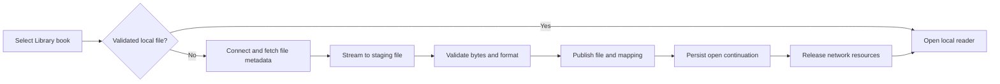

# BookOrbit integration plan

Prepared 2026-09-16. Status: analysis and proposed implementation plan.

Build BookOrbit into the existing Library view, with remote books, covers, an **On device** badge, and download-on-open. Reuse BookOrbit's device catalogue and CrossPoint's EPUB position mapping. Add an SD-backed remote catalogue cache, a durable download handoff, and progress synchronization with conflict detection.

Deliver this in two phases: **Phase 1: connected Library and reliable reading sync**, followed by **Phase 2: BookOrbit reading insights**, including Reader DNA, statistics, goals/streaks, and a reading calendar. Phase 2 displays BookOrbit's account-wide data, including reading on other devices; calculations remain authoritative on the server.

This is a source-based design, not an implemented or hardware-tested integration. No firmware or server source was changed during this analysis.

## Scope and source baseline

- Firmware: `/Users/jkiraly/Workspace/crosspoint-reader`, branch `develop`, commit `045881a58902c4a711f43505267ecb58477f84be`. Its `origin` is the requested personal fork, `https://github.com/fonix232/crosspoint-reader`. The working tree was clean before this document.
- Server: `/Users/jkiraly/Workspace/Projects/bookorbit`, commit `fa50762f632d1ee4747f2d3b6ca92be2a398454a`. The checkout has existing unrelated working changes, including an ABS integration. This plan references the inspected catalogue/sync source, not a claimed deployed server version.
- The firmware's `freeink-sdk` submodule is uninitialized at pinned commit `48f5949730157f335a8777959a85f13fdefd6af9`. SDK implementation details, TLS trust configuration, and UI widget extensions must be checked after initialization. No build or device session was attempted for this documentation task.
- Proposed defaults: one BookOrbit account/server per device; support the constrained ESP32-C3 first; use touch or the existing Confirm button; synchronize with other BookOrbit readers, including web/mobile and KOReader where their format engines support the same file. The cross-reader scope is an assumption pending user preference.
- “Automatic downloads” means selecting a remote book downloads and opens it. Scope is EPUB, plus KEPUB only after compatibility validation. The user explicitly excluded TXT, Markdown, XTC, and XTCH. Bulk downloading the entire library, subscriptions, annotations, DRM handling, and conversion to new formats are separate features.

## What the code already provides

Paths beginning `src/`, `lib/`, or `test/` below are relative to the firmware repository. Paths beginning `server/` or `packages/` are relative to the BookOrbit repository.

| Existing behavior and evidence | Integration consequence |
| --- | --- |
| `src/activities/library/LibraryListActivity.cpp:188` resolves an SD path and calls `onSelectBook`; `:708` materializes only the visible rows; `:777` assigns file-format icons. | Add remote row identity and availability to this screen. Covers are new Library functionality, although other screens already display them. |
| `lib/LibraryIndex/LibraryFormat.h:44` caps the local index at 4,096 records. `ClixRecord` at `:94` describes a local file and has no server/book/file identity. | Do not put every server book into CLIX or increase its limit as the remote-library solution. Keep a separate paginated remote store and combine sources at the screen boundary. |
| `src/activities/reader/ReaderActivity.cpp:27` dispatches local readers; `lib/FsHelpers/FsHelpers.cpp:167` recognizes the `.epub` extension. | Use an explicit EPUB compatibility policy for remote books. An arbitrary extension reaching the EPUB fallback does not establish compatibility. |
| `src/activities/browser/OpdsBookBrowserActivity.cpp:468` downloads; `:553` returns to the feed after success. `src/util/OpdsFilename.cpp:22` always appends `.epub`. | Reuse transfer mechanisms, but implement download-to-reader handoff and format-aware naming for BookOrbit. |
| `src/network/HttpDownloader.cpp:292` streams to SD, removes an existing destination first, and deletes failed transfers. Its public API accepts Basic credentials, not arbitrary device-auth headers. | Add request options for BookOrbit authentication and response metadata. Always transfer to a staging file; never pass an existing downloaded book as the transfer destination. |
| `src/activities/home/HomeActivity.cpp:56` generates local cover thumbnails; `lib/JpegToBmpConverter/JpegToBmpConverter.h:15` supports sized JPEG-to-BMP and one-bit conversion. | Cache remote JPEGs on SD and convert one thumbnail at a time into the existing rendering format. |
| `lib/KOReaderSync/KOReaderDocumentId.cpp:44` and `server/src/modules/scanner/lib/hash.ts:13` compute the KOReader partial-file MD5. Firmware credentials default to filename matching at `lib/KOReaderSync/KOReaderCredentialStore.h:32`. | Use binary matching for BookOrbit. The filename hash is not the server's ordinary file identity. Validate exact-byte hash parity with fixtures. |
| `lib/KOReaderSync/KOReaderSyncClient.cpp:17` uses the same device ID for all CrossPoint devices; `:225` sends progress without an event timestamp. `src/activities/reader/KOReaderSyncActivity.cpp:270` chooses furthest progress in smart mode. | Add a persistent per-device ID and a separate BookOrbit sync policy. Existing manual sync is not a safe automatic offline queue. |
| `src/activities/reader/EpubReaderActivity.cpp:943` saves progress and releases rendering resources before synchronization. Network exits reboot at `src/activities/reader/KOReaderSyncActivity.cpp:412` and `src/activities/browser/OpdsBookBrowserActivity.cpp:69`. | Use bounded network sessions and persistent continuation state. Reuse the reboot-to-reader mechanism where necessary, rather than assuming networking and the reader can remain resident together. |
| `server/src/modules/koreader/koreader-catalog.controller.ts:63` exposes catalogue pages; `:69` a manifest; `:91` thumbnails; `:101` file downloads. | A native BookOrbit provider can reuse these JSON interfaces and their user-scoped access checks. OPDS alone does not provide the complete desired behavior. |
| `server/src/modules/koreader/koreader.service.ts:297` bridges device positions to shared progress; `:343` reads the latest source; `:373` currently falls back from web CFI to chapter start. | Reuse the shared reading-state bridge, but improve exact resume. `server/src/modules/position-converter/position-converter.service.ts:87` already provides point-CFI-to-XPointer conversion. |

## Library behavior

Keep the existing Library entry point. Add an **All / On device** source filter, separate from the existing Recent / Title / Author sorting controls. After setup, All includes the BookOrbit catalogue and local books; On device works without Wi-Fi and includes sideloaded files.

Each book row shows a small monochrome cover, title, author, optional progress, and availability:

| State | Row indication | Select / tap |
| --- | --- | --- |
| Remote only | Download icon and “In library” | Connect if needed, download, then open |
| Complete local file | Checkmark and “On device” | Open the local file immediately |
| Download active | “Downloading 42%” or received size if total is unknown | Show progress/cancel; suppress duplicate starts |
| Failed download | “Download failed” | Retry without losing a previous complete copy |
| Cached remote entry while offline | Remote availability plus screen-level offline status | Explain that a connection is needed; local rows still open |

Missing covers use the existing format icon. Refresh and Sync now are explicit actions; a small last-sync/offline indicator makes cached state understandable. All text uses `tr()` and layout goes through the existing GUI/FreeInkUI boundary, with orientation-aware dimensions.

Keep one logical row for a matched local/remote book. The authoritative identity is the account namespace plus BookOrbit `bookId` and `fileId`; a filename or title is not sufficient. Offer a format choice only when more than one approved compatible file is available, remember that selection, and prefer the existing downloaded format. EPUB is the initial default.

The All view uses server pagination/sorting for catalogue books, with a clearly labeled local-only section for unmatched sideloaded books. This avoids pretending that two separately sorted sources are globally sorted. Search applies to both sections. On device sorts the local union, including managed downloads. Match sideloads lazily or through an explicit scan using binary hashes; never silently match by title.

Long press on a managed book offers **Remove from device**. This removes its local bytes after preserving unsynced progress, returns the row to remote-only, and never deletes the server book. A server deletion or access change does not automatically erase a previously downloaded file. Account changes detach the old account's cache/outbox; old changes must never upload under new credentials.

## Format policy

BookOrbit's current format list (`packages/types/src/library.ts:8`) includes EPUB/KEPUB and several formats CrossPoint cannot read. This integration is scoped to EPUB and validated EPUB-compatible KEPUB files.

| Format | Delivery plan |
| --- | --- |
| EPUB | First complete integration slice: browse, covers, download, exact-position sync where resolvable. |
| KEPUB | Validate the actual downloadable EPUB container and position round trips before advertising. If supported, save with an EPUB-recognized extension while preserving the server file identity and exact bytes. KEPUB-specific markup requires fixtures. |
| PDF / MOBI / AZW / FB2 / comics / audio | Filter out unless a separately validated compatible file exists for the same book. This integration does not add renderer engines. |

Use the intersection of tested firmware capabilities and accessible downloadable server files. Filtering must happen before pagination/counting on the server. The existing catalogue accepts one `format` (`server/src/modules/koreader/dto/koreader-catalog-query.dto.ts:82`); extend it with a validated format set/profile for multi-format delivery. Do not fetch an arbitrary page and discard incompatible rows on the device, which creates empty pages and misleading totals.

## Firmware components and persistence

Introduce small boundaries with explicit ownership:

1. **BookOrbitClient and BookOrbitCredentialStore**: base URL, device credentials, persistent random device ID, capability negotiation, bounded JSON requests, streaming downloads, typed error results. Pattern the settings screen on `src/activities/settings/KOReaderSettingsActivity.cpp` and registration at `SettingsActivity.cpp:102`. Keep BookOrbit credentials independent of another configured KOReader server.
2. **BookOrbitCatalogStore / Library data-source adapter**: remote page cache, account-scoped book/file metadata, local-file mappings, and visible-row access for `LibraryListActivity`. Keep the existing CLIX local source. Managed downloads must remain discoverable even if the local CLIX cap is reached; use their persistent mapping index as an additional local source.
3. **BookOrbitDownloadActivity / transfer coordinator**: cancellable foreground state machine, validation, publication, and open-after-download continuation. One active transfer on C3.
4. **BookOrbitProgressStore / sync coordinator**: durable coalesced pending updates, last synchronized revision, conflict resolution, and EPUB locator mapping. Share no network state with rendering callbacks.

Proposed SD layout, all accessed through `HalStorage`/`HalFile`:

```text
/.crosspoint/bookorbit.json                         configuration/credential store
/.crosspoint/bookorbit/<account>/catalog/            cached pages and index
/.crosspoint/bookorbit/<account>/covers/             bounded thumbnail cache
/.crosspoint/bookorbit/<account>/files/              fileId -> local path/version/hash
/.crosspoint/bookorbit/<account>/progress/           acknowledged state and pending edits
/.crosspoint/bookorbit/<account>/transfers/          transfer journals and staging files
/Books/BookOrbit/<account>/<bookId>/<fileId>.epub     example managed final path
```

Account namespaces bind to canonical server identity and account identity. Store human-readable titles in metadata rather than relying on filenames. Validate all remotely supplied URLs and paths; do not concatenate `devicePath` directly into an SD path.

Persist records with schema version, length/checksum, generation number, and recoverable temporary/previous generations. Readers must select the last complete generation after power failure. FAT replace is not an atomic transaction: `src/activities/reader/ProgressFile.h:22` explicitly describes its remove-before-rename gap. Catalogue, download mapping, and progress acknowledgements need recovery rules for each interruption point.

Cache the pages already visited and their query/sort keys. Offline search covers local books and cached catalogue data and says so; it does not claim to search uncached remote books. A full offline catalogue mirror is optional later work. A normal page refresh stages data before swapping the visible generation; malformed, truncated, or stale responses retain the prior usable page.

## BookOrbit API contract

Use a configurable origin/base path and the existing KOReader device credentials created in BookOrbit settings. Current authentication is `x-auth-user` and `x-auth-key`; see `server/src/modules/koreader/koreader-auth.guard.ts:20`. It requires an active account, enabled sync, and the KOReader sync permission. No firmware account registration is needed; the server explicitly rejects it at `koreader.controller.ts:58`.

| Existing endpoint, under `/api/v1` | Use / caveat |
| --- | --- |
| `GET /koreader/users/auth` | Validate configured credentials. |
| `GET /koreader/plugin/catalog/books?page=1&size=20&format=epub&sort=title` | Initial catalogue. Keep page size bounded; query supports search and sorting. |
| `GET /koreader/plugin/catalog/books/:bookId` | Select a compatible downloadable file when necessary. Detail can include primary and content roles, while the download route accepts content only; honor this distinction (`koreader-catalog.service.ts:703`, `:496`). |
| `GET /koreader/plugin/catalog/manifest?ids=<bookId>&size=1` | Retrieve exact file identity, size, contentVersion, and partial MD5 before downloading (`packages/types/src/koreader.ts:351`). Ordinary detail lacks version/hash fields. |
| `GET /koreader/plugin/catalog/books/:bookId/thumbnail` | Existing JPEG thumbnail with ETag/304 (`koreader-catalog.service.ts:474`). |
| `GET /koreader/plugin/catalog/files/:fileId/download` | Streams exact file bytes and Content-Length. The inspected handler has no Range/resume contract (`koreader-catalog.service.ts:494`). |
| `GET /koreader/syncs/progress/:documentHash` and `PUT /koreader/syncs/progress` | Useful compatibility proof using existing firmware mapping. Not sufficient on their own for safe automatic conflict handling. |
| `POST /koreader/plugin/progress` | Existing bounded bulk upload applies timestamp-based staleness checks. Its response reports accepted hashes without per-item shared/stale outcome (`koreader-plugin.service.ts:203`); it is not a revision-based synchronization exchange. |

Add the following narrowly scoped server support for the complete integration:

- A device capabilities response advertising supported contract version, format profile, thumbnail variants, and progress-exchange support. Existing `/plugin/version` describes the KOReader plugin package, not this contract.
- Multi-format filtering and a compact optional list projection containing the chosen file ID/version/hash/size. This can remove the detail/manifest round trip later; initial firmware can use the existing calls above.
- Optional bounded small JPEG or one-bit thumbnail variant. Existing thumbnails are up to 400 x 600 (`server/src/modules/metadata/lib/cover.ts:13`), so server resizing reduces bytes and decoder work. Device conversion of the existing JPEG is a valid initial path and should be measured first.
- Precise web-to-device position conversion using the existing `cfiPointToXpointer`, and a progress exchange with revisions and idempotency as specified below. Keep current KOReader routes backward compatible.

All server extensions use DTO validation, shared `packages/types` definitions, user/file access checks, and the existing feature services. Test permission revocation on catalogue, cover, download, and progress operations, not only at login.

TLS is an implementation prerequisite: `platformio.ini:60` selects wolfSSL, while `src/network/HttpDownloader.cpp:75` and `lib/KOReaderSync/KOReaderSyncClient.cpp:63` call `setInsecure()`. Do not inherit that behavior for the new provider. Verify the pinned SDK's CA/pinning support; define self-hosted certificate provisioning. Never downgrade HTTPS redirects or forward credentials to another origin. The existing credential store's XOR obfuscation is not encryption (`KOReaderCredentialStore.h:20`); store device-scoped credentials without presenting it as secure encryption.

## Download and open transaction



Before transfer, check SD presence/free space and leave room for the existing copy plus staging data. Use stable IDs for filenames and a content-version-specific staging path. Record expected size/hash/version before transferring. Throttle e-ink progress refreshes, and poll cancellation independently of known content length.

Completion means successful HTTP framing, expected byte count when available, structural format validation, and matching partial MD5 when supplied. Partial MD5 is a matching fingerprint, not a full-file integrity guarantee; add a streaming strong checksum when the server exposes one. If the server file changes during transfer, revalidate version/identity and retry against fresh metadata. A null hash must not become a false successful match.

Flush/close the staging file, publish it to a new versioned final path, then publish the mapping generation. Reconcile orphan complete files or unfinished journals at boot. Only then mark **On device**. Preserve the old complete version until replacement is committed; active reading remains pinned to that version until a deliberate update/remap. Removing a failed staging file must never delete the good version.

Initial interrupted transfers retry from the beginning, which the current endpoint supports. Byte-range resumption is a later enhancement requiring Range/206/Content-Range and version validators on both sides. Never append a full 200 response to a partial file.

Persist a one-shot continuation containing account/file identity, verified path, and intended reader action before a network teardown reboot. Reuse `src/main.cpp:177` and the existing reader restore path, extending them where needed. Consume the continuation once, verify the file still exists, and retain Library selection separately. This prevents returning to Home, opening a different recent book, or entering a download/reboot loop.

## Progress synchronization

Use a content locator as the resume anchor and percentage as display/fallback data. KOReader wire percentages are 0..1 (`koreader-progress.dto.ts:12`), while BookOrbit's ordinary reader API uses 0..100 (`server/src/modules/book/dto/save-progress.dto.ts:12`). Convert explicitly at the boundary.

- **EPUB:** reuse `ProgressMapper` and `ChapterXPathResolver`, including visible-text offsets. Round-trip through BookOrbit's XPointer/CFI converters for the same file version. Never exchange rendered page numbers as the portable authority. Unsupported/malformed locators yield an explicitly approximate percentage/chapter fallback, not an invented exact position.
- **Validated KEPUB:** use the EPUB mapping against that exact server file. Do not assume a position from a different EPUB/KEPUB rendition can be applied without server-side conversion.

Queue snapshots after successful local progress saves, debounce writes while reading, and force a durable final snapshot on book close/sleep. Locator generation that borrows the framebuffer must run under the established rendering exclusion, outside network callbacks. No Wi-Fi connection per page turn.

Synchronize on explicit Sync now, Library refresh/network sessions, and book-open/close opportunities when a connection is available. Flush on close before releasing resources when feasible; sleep has a strict time budget and otherwise leaves the durable update for the next connection. Reading always works offline. Do not silently reposition an already displayed page when a delayed response arrives: guard by account, file, session, and local revision; offer the newer location or apply it on the next open.

The proposed exchange request includes `fileId`, `contentVersion`, `deviceId`, `clientMutationId`, `baseRevision`, locator type/payload, and percentage. The response returns applied/conflict/duplicate status plus authoritative revision and position. These are **new contract fields**, not fields the current DTO accepts.

Conflict rules:

1. Server revision unchanged since last acknowledgement: apply the pending local update, including intentional backward movement.
2. No pending local update and a newer server revision: offer/apply the remote location at the safe open boundary.
3. Both changed: retain both positions and ask which to use. Never automatically choose the larger percentage; that loses rereads and intentional jumps.
4. A retry with the same mutation ID returns the prior acknowledgement. Remove only that acknowledged local generation; a newer queued update must remain.
5. Changed file version or ambiguous identity: preserve progress and require rematching/remapping before applying it to different bytes.

Enforce revision comparison and mutation application atomically on the server. Every writer of shared reading progress, including web/mobile, existing KOReader routes, Kobo bridges, resets, and the new endpoint, must participate in the same revision mechanism. A revision used only by CrossPoint would miss external updates and would not solve conflicts. Keep rendering/conversion outside long database locks, then recheck the relevant version/revision before commit. Generate schema migrations with Drizzle tooling.

Timestamp-based upload is useful for a compatibility prototype, but cannot reliably arbitrate offline reads on devices without a valid clock (`lib/hal/HalClock.h:25`). Do not stamp an old queued reading position with reconnect time. Current bulk timestamp staleness checks and furthest-progress firmware behavior are evidence for adding the stronger exchange, not substitutes for it.

## Memory and network lifecycle

The C3 budget in `AGENTS.md:10` is the design floor. Proposed starting limits below are allocations to measure, not claims of observed heap use:

- One API page, initially 20 rows, retained as compact bounded records on SD. Decode one record at a time; keep only visible labels in RAM. No vector of the entire remote library and no whole-response `getString()` for catalogue bodies.
- Reuse `lib/JsonParser/StreamingJsonParser.h:19` after defining overflow/completion behavior. Its token buffer is 512 bytes and nesting limit 32; IDs/URLs/locators must never be silently truncated. Either provide a dedicated bounded larger locator parser or stream those fields separately. Allow UTF-8-safe display truncation for titles only.
- One reusable heap transfer buffer around the current 1 KiB chunk size, one parser arena, and one thumbnail decode at a time. Allocate them fallibly for the network activity and reuse them; stack allocation is rejected for buffers above the repository's 256-byte local-variable guidance, and permanent static reservations would consume scarce RAM while reading.
- A 64 x 96 one-bit image is 768 bytes of pixel payload, excluding BMP headers and decoder workspace. Decode/cache visible covers sequentially, release JPEG workspace before TLS, and enforce an SD thumbnail quota with eviction. Actual row dimensions follow theme/orientation metrics.
- Release cover decoding and EPUB section/font/image caches before starting TLS. Existing downloader preflight checks are 40,000 free bytes and a 20,000-byte largest block (`HttpDownloader.h:30`), not a guarantee. Measure minimum free heap, largest block, and stack high-water marks over repeated sessions; use the repository's >50 KiB free-heap target for acceptance or redesign before shipping.
- Prefer a cooperative network activity and existing callbacks. Add a worker task only if cancellation/latency measurements require it; its stack and lifetime then need an explicit budget. All background work must stop before the owning activity is destroyed.

## Phase 1: implementation sequence and acceptance

These are proposed work packages, not started implementation tasks. A firmware developer owns firmware packages, a BookOrbit developer owns server changes, and an independent reviewer/hardware tester validates the integration.

| Order | Work package | Dependencies and acceptance |
| --- | --- | --- |
| 1 | Contract and constrained-device proof | Initialize the pinned SDK; verify certificate trust; use representative EPUB bytes to confirm auth, paginated catalogue, cover conversion, hashes, download, and position round trips. Record heap/stack and handshake peaks on C3. Confirm deployed server compatibility. |
| 2 | Settings and BookOrbit transport | After 1. Configure/test credentials and persistent device/account identity; add bounded requests, headers/status/ETag handling, errors and cancellation. Verify wrong credentials, path-prefixed deployments, TLS failures, redirects, and two distinct devices. |
| 3 | Library catalogue and covers | After 2. Introduce SD page cache and Library data sources; implement All/On device, local-only section, badges, search/sorting and placeholders. A 50,000-book server fixture must remain fully browsable online without exceeding CLIX or allocating RAM proportional to library size. |
| 4 | Download-on-open | After 2 and basic row activation from 3. Publish verified files/mappings, reconcile restart state, and open the chosen book automatically. Validate cancel, storage-full, disconnect, power cuts, repeated taps, file updates, removals, and index overflow. |
| 5 | Shared progress contract and precise EPUB conversion | Server work can proceed after 1. Add shared revisions/idempotency and accurate point conversion, preserving existing clients. Concurrent web/device writes, resets and retries must produce deterministic applied/conflict results without lost updates. |
| 6 | Firmware durable EPUB sync | After 2, 4 and 5. Queue/replay progress, restore content position across layout changes, arbitrate conflicts and obey sleep budgets. Demonstrate CrossPoint-to-web/mobile/KOReader and reverse on identical EPUB bytes. |
| 7 | KEPUB compatibility decision | After the EPUB slice is stable. Validate downloadable KEPUB containers and exact-position round trips. If they pass, enable the KEPUB capability and server-side format-set filtering; otherwise keep those files excluded with the limitation documented. |
| 8 | Release validation and user guide | After 3-6 and the decision in 7. Exercise C3 and the intended touch target, all orientations, disconnected use, long sessions, account changes, and server upgrades/downgrades. Document setup, approximate-position fallback, cache scope, and removal behavior. |

The first useful milestone is packages 1-4: browse the remote EPUB library with covers, see local availability, select a book, and read the downloaded copy. The requested integrated experience is complete only with reliable sync; the milestone is not a substitute for that requirement.

## Phase 2: BookOrbit reading insights

Add **Reading insights** as a BookOrbit area reachable from Home and the Library menu. It reuses phase 1's account identity, transport, cache, and network-session lifecycle. Reading remains the primary Home action; offer a compact optional goal/streak summary rather than filling the Library with dashboard widgets.

The first phase-2 release is a read-only view of BookOrbit's existing account data. Goals are configured in BookOrbit, and the firmware displays their progress. Account-wide insights include supported BookOrbit sources such as other readers and audiobooks; the firmware's EPUB download filter must not silently filter the user's statistics. Clearly identify the reporting period and source scope, distinguishing reading and listening where BookOrbit provides that breakdown.

### Screens and behavior

| Screen | Proposed device experience | BookOrbit authority |
| --- | --- | --- |
| Overview | Reading time for the selected period, completed books, current/longest streak, and annual goal progress; small weekly bars and links to the other views. | Goal/streak DTOs at `packages/types/src/dashboard.ts:84` and `:104`; daily totals and summary at `packages/types/src/user-statistics.ts:3` and `:11`. Summary counts are not automatically annual counts: use the server's matching period-specific value. |
| Reader DNA | Archetype, books analyzed, and five labeled horizontal bars for length, variety, rhythm, time preference, and speed. Display BO's scores and labels without reproducing its classification algorithm. | `packages/types/src/dashboard.ts:163`; `server/src/modules/dashboard/dashboard-widget.service.ts:170` currently analyzes the preceding six months. |
| Goals and streaks | Annual books-completed target with a progress bar, seven-day streak strip, and optional year-end projection. Show “No goal set” when the target is null. | `server/src/modules/dashboard/dashboard.controller.ts:33`, `:43`, and `:63`. The current goal contract is an annual book target, not configurable daily minutes/pages goals. |
| Reading calendar | Month grid with daily reading intensity; previous/next month; selected-day minutes and source breakdown; highlight the busiest day. Show the month's total and active days. | Heatmap rows contain day, reading seconds, events, and optional per-source seconds at `packages/types/src/user-statistics.ts:11`. Historical month paging needs a bounded date-range API extension. |
| Reading habits | Best weekday and peak reading hours, using a seven-bar weekday chart and a compact 24-hour histogram or grouped time bands. | `server/src/modules/user-statistics/user-statistics.controller.ts:36` and `:41`. This answers “when do I read most?” beyond total activity by date. |

For the calendar, use a 7-column, up-to-6-row month grid. Render four fixed, labeled intensity bands using monochrome fill patterns or hatching, with distinct treatments for today, selection, future dates, and unavailable data. The legend expresses minutes and stays consistent across months so comparisons remain meaningful. A confirmed zero is an empty day; missing or not-yet-aggregated data must not masquerade as zero. Tap a day to inspect it; directional buttons move selection and Confirm opens its detail. A full-year heatmap is an optional later overview if it remains legible on the target screen.

Month/day detail should initially show only data already available: time and source breakdown. A list of books/sessions for that day is a subsequent enhancement using a bounded detail response, not an inference from the aggregate row. Links to a book use the phase-1 open/download flow only when that book has a compatible file; statistics can still mention books that this firmware cannot open.

Use an explicit “Updated …” indicator with cached/offline status. Refresh on entry when a network session is available and through Refresh/Sync now; no continuous polling or network activity inside chart rendering. An empty history shows a useful empty state. For DNA, `booksAnalyzed == 0` must not present an evidence-free archetype as established; speed with BO's `N/A` label is unavailable, not a measured zero (`server/src/modules/dashboard/dashboard-widget.calculations.ts:298`).

### Existing APIs and required server work

These existing routes are under `/api/v1`:

| Existing route | Reuse and limitations |
| --- | --- |
| `GET /koreader/plugin/catalog/dashboard` | Already includes `readingGoal` and `readingStreak`, plus other dashboard data (`server/src/modules/koreader/koreader-catalog.service.ts:157`). Useful for an initial summary, but avoid downloading the full dashboard for every small refresh. |
| `GET /dashboard/widgets/reading-dna` | Existing DNA computation; route at `server/src/modules/dashboard/dashboard.controller.ts:73`. |
| `GET /dashboard/widgets/reading-goal`, `/reading-streak`, `/year-projection`, `/reading-rhythm` | Reuse widget services and semantics. The rhythm shape supplies dated reading seconds and consistency at `packages/types/src/dashboard.ts:200`. |
| `GET /user-statistics/summary`, `/daily-reading`, `/reading-heatmap`, `/peak-hours`, `/favorite-days`, `/goal-trajectory` | Existing statistics services; routes at `server/src/modules/user-statistics/user-statistics.controller.ts:16`. Heatmap takes a trailing `days` window, not a requested historical month (`server/src/modules/user-statistics/dto/user-daily-reading-query.dto.ts:4`). |

The dashboard/statistics controllers use the ordinary authentication path, unlike the device-authenticated KOReader catalogue. Do not assume `x-auth-*` credentials authorize those web routes. Add a small, versioned, read-only device insights facade under the BookOrbit device API, using the existing user-scoped services and access checks. Advertise it in the phase-1 capabilities response; older servers omit/disable unavailable insight sections without breaking reading.

Historical proposal, superseded by the official widget/statistics contract documented in [bookorbit.md](bookorbit.md#reading-insights-phase-2):

- `GET /koreader/plugin/insights/summary`: compact goal, streak, DNA, and period totals, with explicit nullable/unavailable fields and per-section freshness.
- `GET /koreader/plugin/insights/calendar?month=YYYY-MM`: one bounded month of daily totals, account timezone, source scope, and aggregation coverage.
- `GET /koreader/plugin/insights/habits?days=90`: fixed-size weekday/hour buckets. Add paginated day/session detail only if that UI is implemented.

Each response includes a schema version, `generatedAt`, reporting timezone/period, and a data-through watermark where applicable. Support conditional refresh with ETag and account-scoped caching. Apply the account's accessible-library/content restrictions to all aggregates and cache keys; extending authentication must not expose statistics from inaccessible books. Compare facade results against the existing BO services for the same period/scope.

Resolve timezone and freshness semantics on the server before promising an accurate calendar. The current heatmap service constructs UTC day windows (`server/src/modules/user-statistics/user-statistics.service.ts:165`), while session ingestion resolves the account timezone (`server/src/modules/koreader/koreader-stats.service.ts:55`). Use a single documented timezone rule across daily totals, streaks, goals, and hourly buckets; split sessions spanning local midnight appropriately and test DST. The device displays supplied date keys, without re-bucketing them in its own timezone.

Statistics are not necessarily live: `server/src/modules/user-statistics/user-statistics-aggregation.job.ts:16` runs hourly and recomputes two recent days. Show honest aggregation freshness, and ensure late offline sessions invalidate/recompute every affected historical day, including data older than that window. Do not label a successful position upload as “statistics up to date.”

### Make CrossPoint reading contribute to BO data

Displaying existing BO insights can ship first. To include time spent reading on CrossPoint, add a separate durable **reading-session outbox**. Phase 1's coalesced latest-position queue cannot represent duration, rereading, or multiple sessions and must not be repurposed for this.

Capture active reading intervals while a page is displayed, suspend during menus/network transfers/sleep, and use a documented idle timeout to avoid counting an abandoned open book as hours of reading. Hook the existing reader lifecycle (`src/activities/reader/ReaderActivity.cpp:49` and `:72`) and actual page-display transitions. Elapsed time uses a monotonic clock; date attribution requires a valid wall-clock anchor. Persist device/session/event identity, account and exact book-file identity, elapsed duration, and known timestamps. If time is untrusted across a reboot, mark the interval undated instead of assigning it to reconnect day.

There is already `POST /koreader/plugin/page-stats` (`server/src/modules/koreader/koreader-plugin.controller.ts:45`), with page/start-time/duration/total-pages events (`server/src/modules/koreader/dto/koreader-plugin.dto.ts:93`) and duplicate handling/session derivation (`server/src/modules/koreader/koreader-stats.service.ts:42`). Evaluate reuse against CrossPoint pagination first. Never pass a chapter-local page number as a whole-book page: doing so would corrupt derived progress and speed. If CrossPoint cannot provide those semantics reliably, introduce a small device-session ingestion DTO backed by the existing session/statistics services; do not fabricate page counts.

Deduplicate retries by stable device/session/event identity, acknowledge only the uploaded generation, and retain the rest after failure. A normal progress update plus a session upload must not double-count the same reading time or completed-book event. Keep source attribution honest: extend BO's source mapping if CrossPoint deserves a separate bucket; do not relabel existing KOReader data on the device. Recompute affected aggregates after accepted sessions, then refresh insights. Server-side totals remain authoritative; pending local minutes may be shown separately as “Not synced” but are not silently added to BO totals.

### Resource budget and delivery order

Draw charts with existing GUI primitives into the normal framebuffer. No web dashboard, browser, or client-side chart library runs on the firmware. Cache compact insights under `/.crosspoint/bookorbit/<account>/insights/`, with bounded retention (for example, the current and previous two months). Load one month's at-most-31 daily records plus a 42-cell calendar layout, one bounded DNA record, and fixed 7/24-element habit arrays. Reuse fallible screen-lifetime heap storage where these exceed the stack guidance; evict old month caches rather than retaining an unbounded history. Release transport buffers before drawing. Rendering and navigation work entirely from cached data.

| Package | Deliverable | Acceptance |
| --- | --- | --- |
| 2A | Read-only insights API facade and cache contract | Device credentials authorize only the current user's permitted data; bounded payloads; explicit periods/timezone/freshness; capability fallback for older BO versions. Depends on phase-1 transport/account foundations. |
| 2B | Overview, Reader DNA, goals and streaks | Display BO's values faithfully, including null goal, missing speed, empty history and stale data. All screens work offline from cached snapshots and through touch/buttons. |
| 2C | Monthly calendar and reading habits | Correct month navigation, leap years, local-midnight/DST behavior, stable intensity legend, day detail, and weekday/hour summaries. A missing month never appears as an all-zero month. |
| 2D | CrossPoint session capture and ingestion | Reading on the device contributes exactly once after offline/reboot/retry; idle/menu/sleep time is excluded; late events update historical days; no invented timestamps or page metrics. Depends on phase-1 durable sync and server session semantics. |
| 2E | Integration and hardware acceptance | BO and firmware agree on metrics for the same data scope; account switching clears visibility; revoked access and old caches are handled; repeated insights/network/reader transitions meet C3 memory and sleep constraints. |

Ship 2A-2C as the useful first phase-2 milestone using existing BookOrbit history, then 2D to complete the device's contribution. Additional small BO features can follow: monthly challenges (`server/src/modules/dashboard/dashboard.controller.ts:58`), recently earned achievements, year projections, and a favorite/highlight-of-the-day card. Keep these optional so the core overview, DNA, and calendar remain focused. New goal types, goal editing, annotation authoring, and reproducing every web statistics visualization are outside this phase.

Phase-2 validation extends the existing dashboard/statistics tests with facade authorization, null/empty cases, timezones, aggregation freshness and delayed ingestion. Firmware tests cover bounded parsing/cache recovery, calendar date navigation, and session replay; hardware checks cover monochrome legibility, all orientations, touch/button focus, offline browsing, long idle periods, sleep, and bounded memory. These are implementation acceptance requirements, not tests executed during this planning update.

## Verification plan

Extend existing host suites around Library format/indexing, streaming JSON, XPath resolution and progress comparison (`test/CMakeLists.txt:41`). Add behavior tests for remote cache transactions, account scoping, duplicate identity, format filtering, download journals, one-shot handoff, and progress mutation acknowledgement. Use interruption injection at each persistent publication step and malformed/oversized/truncated HTTP fixtures.

Relevant implementation-time commands, not executed by this analysis:

```sh
cmake -S test -B build/test
cmake --build build/test
ctest --test-dir build/test --output-on-failure
pio run -e default
pio run -e sticky
```

Select the actual additional hardware environment instead of `sticky` if appropriate. Initialize SDK/build dependencies first. On the server, run targeted Vitest suites for catalogue/auth, file access/streaming, progress exchange, and position conversion, then the affected type/lint checks. Database concurrency and multi-user isolation require integration tests in an isolated test database.

Hardware acceptance includes: cached browsing without Wi-Fi; local opening while the server is down; precise EPUB round trips across fonts/orientations; two devices reading offline then reconnecting in either order; intentional rereads and resets; download power loss; an untrusted certificate; full/missing SD; repeated Library/download/reader transitions; sleep during a transfer; and no monotonic loss of free heap/largest block. Observe the proposed `/.crosspoint/bookorbit/` journals/caches alongside serial diagnostics.

The principal open dependencies are the pinned SDK's TLS/UI capabilities, the actual deployed BookOrbit version, the desired cross-reader scope, and hardware memory measurements. These affect implementation choices, but do not prevent preparing this plan.
